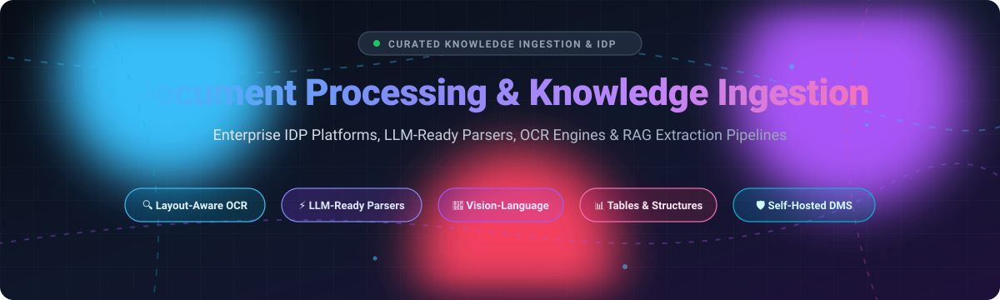

# Awesome Knowledge Ingestion & Document Processing 🚀

 

 
 

**A curated index of top Knowledge Ingestion Engines, Intelligent Document Processing (IDP) Platforms, LLM-Ready PDF/Markdown Parsers, Vision-Language Layout OCR Models, and RAG Data Extraction Pipelines.**

*Discover commercial cloud-hosted SaaS solutions alongside state-of-the-art open-source alternatives for AI workflows, document parsing, multimodal LLMs, and enterprise ETL.*

🌟 **Star if you find this repository helpful!** 🌟

---

## 📑 Table of Contents

- [🌐 Sector Overview & Market Dynamics](#-sector-overview--market-dynamics)
- [☁️ SaaS & Hosted Platforms](#️-saas--hosted-platforms)
- [💻 Open-Source Equivalents & Tools](#-open-source-equivalents--tools)
  - [⚡ LLM-Ready Document Parsers & RAG Ingestion Engines](#-llm-ready-document-parsers--rag-ingestion-engines)
  - [📄 Document Layout Analysis & End-to-End PDF-to-Markdown Models](#-document-layout-analysis--end-to-end-pdf-to-markdown-models)
  - [🔍 High-Accuracy OCR & Multilingual Text Extraction Engines](#-high-accuracy-ocr--multilingual-text-extraction-engines)
  - [📊 Table Extraction, Forms & Structured Information Parsers](#-table-extraction-forms--structured-information-parsers)
  - [🛡️ Self-Hosted Document Management & OCR Pipelines](#️-self-hosted-document-management--ocr-pipelines)
- [📈 Star History](#-star-history)
- [💖 Support & Sponsorship](#-support--sponsorship)
- [🤝 Contributing](#-contributing)

---

## 🌐 Sector Overview & Market Dynamics

The global **Intelligent Document Processing (IDP)** and Document AI market is valued at approximately **$3.0B – $3.9B** and is projected to expand rapidly at a Compound Annual Growth Rate (CAGR) of **16% – 33%**, heading toward **$7B – $30B+ by the mid-2030s**. 

The sector is characterized by **moderate fragmentation**:
- **Cloud Hyperscalers & Enterprise Giants:** The top 4 to 5 major vendors (Microsoft Azure, AWS, Google Cloud, and traditional capture vendors) command approximately **38% – 45%** of global market revenue (Herfindahl-Hirschman Index around 900–1,100).
- **Domain Specialization & GenAI Disruption:** Niche vendors and open-source models continue to thrive in parallel, driven by vertical specialization (healthcare EHRs, legal filings, tax compliance) and the rapid emergence of multimodal Vision-Language Models (VLMs) and RAG token chunkers that democratize complex layout comprehension.

---

## ☁️ SaaS & Hosted Platforms

Commercial, cloud-hosted Intelligent Document Processing (IDP) APIs, enterprise OCR services, and managed RAG document ingestion platforms.

| Product | Company Size (Valuation / Revenue) | Starting Tier Pricing | Free Tier / Trial Limits | Description |
| :--- | :--- | :--- | :--- | :--- |
| **[Microsoft Azure AI Document Intelligence](https://microsoft.com)** | **$3.1T+** Market Cap / $245B+ Annual Rev | $1.50 / 1,000 pages (Read OCR); $10.00 / 1,000 pages (Layout/Prebuilt); $30.00 / 1,000 pages (Custom) | **500 pages/month free forever** (F0 Tier, max 2 pages per transaction) | Enterprise cloud document AI platform extracting text, key-value pairs, tables, and structures from docs. |
| **[Amazon Textract](https://amazon.com)** | **$2.1T+** Market Cap / $620B+ Annual Rev | $1.50 / 1,000 pages (Detect Text); $15.00 / 1,000 pages (Tables); $50.00 / 1,000 pages (Forms) | **3-Month Free Trial**: 1,000 pages/mo (Detect Text), 100 pages/mo (Tables/Forms/Expenses), 2,000 pages/mo (Lending) | Managed AWS machine learning service automatically extracting printed text, forms, and tables. |
| **[Google Cloud Document AI](https://google.com)** | **$2.0T+** Market Cap / $350B+ Annual Rev | $1.50 / 1,000 pages (Enterprise OCR); $10.00 / 1,000 pages (Layout); $30.00 / 1,000 pages (Form Parser) | **1,000 pages/month free forever** (Enterprise Document OCR) + **90-Day Free Trial** with $300 GCP credits | Enterprise document understanding platform transforming unstructured documents into structured JSON. |
| **[Hyperscience](https://hyperscience.com)** | **$1.6B** Valuation / ~$40M–$50M ARR | Enterprise subscription starting at ~$40,000+/year (~$3,330/month) based on document volume | **Sales-led custom pilot/demo only** (no public self-serve free trial or free tier) | Enterprise ML automation platform built for high-accuracy handwritten and complex document ingestion. |
| **[Rossum](https://rossum.ai)** | **~$500M–$1B** Valuation (Acquired by Coupa) / ~$22M–$28M ARR | Starter tier starting at $18,000/year (~$1,500/month) for core AI extraction & email/API ingestion | **14-day free trial** with sample document workflows (no ongoing free tier) | Cloud-native, AI-first transactional document and invoice processing platform. |
| **[Unstructured.io Platform](https://unstructured.io)** | **$230M** Valuation / ~$7M–$12M ARR | Serverless Pay-as-you-go starting at $0.010 – $0.015 / page ($10 – $15 / 1,000 pages) | **10,000 pages free one-time signup credit** (serverless API, no credit card required) | Commercial ETL+ platform ingesting, transforming, and chunking unstructured PDFs/docs for LLMs. |
| **[LlamaParse (LlamaCloud)](https://llamaindex.ai)** | **$89M** Valuation / ~$5M+ ARR | Pay-as-you-go starting at $1.25 – $1.50 / 1,000 credits; Pro plan starting at $500/month | **10,000 free credits/month free forever** ($0/month tier) | GenAI-native document parsing by LlamaIndex for complex tables, embedded charts, and multi-column PDFs. |
| **[Nanonets](https://nanonets.com)** | **~$60M–$100M** Valuation / ~$10M–$15M ARR | Starter tier at $100/month (includes 100 credits; usage at $0.02–$0.30/block run) | **$50 free trial credits** upon sign-up (no credit card required; no permanent free tier) | No-code AI workflow automation and OCR platform extracting structured data from documents. |
| **[Klippa DocHorizon](https://klippa.com)** | **~$20M–$50M** Valuation (Acquired by Doxis/SER Group) / ~$16M–$21.5M ARR | Custom enterprise quote; specialized modules like SpendControl start at €95/month (~$100/mo) | **Sales-assisted developer sandbox demo** with limited test credits (no permanent free tier) | AI-powered IDP and mobile scanning SDK platform providing OCR, extraction, and document classification. |
| **[Docsumo](https://docsumo.com)** | **~$15M–$25M** Valuation / ~$10M–$12.3M ARR | Volume-based custom subscription starting at ~$500/month | **1,000 pages free trial limit** (access to pre-trained models, 10 user licenses, webhooks) | Document AI platform built for automated data capture and straight-through processing of financial docs. |

---

## 💻 Open-Source Equivalents & Tools

Free and open-source software (FOSS) document ingestion pipelines, Vision-Language document parsers, OCR toolkits, table extractors, and self-hosted DMS platforms. Each category is ranked by GitHub star count in descending order.

### ⚡ LLM-Ready Document Parsers & RAG Ingestion Engines

* **[MarkItDown (Microsoft)](https://github.com/microsoft/markitdown)**  - Fast, lightweight open-source Python utility for converting Office files, PDFs, audio, and web pages into clean Markdown for LLMs.
* **[RAGFlow](https://github.com/infiniflow/ragflow)**  - Deep document understanding-based open-source RAG engine extracting structure from complex documents with visual preview.
* **[Docling (IBM Research)](https://github.com/DS4SD/docling)**  - State-of-the-art open-source document converter parsing PDF, DOCX, PPTX, XLSX, HTML, and images into structured Markdown/JSON for GenAI.
* **[Unstructured (Open-Source Library)](https://github.com/Unstructured-IO/unstructured)**  - Comprehensive open-source Python library providing modular partitioning, cleaning, and chunking pipelines for dozens of file formats.
* **[Kreuzberg](https://github.com/goldziher/kreuzberg)**  - High-performance, modern open-source text extraction library for Python with async support, OCR fallback, and minimal dependencies.
* **[MegaParse](https://github.com/quivrhq/megaparse)**  - Open-source, zero-information-loss document parser tailored for LLM ingestion across PDFs, PowerPoints, and Word documents.
* **[Chonkie](https://github.com/chonkie-inc/chonkie)**  - Lightweight, no-nonsense chunking library engineered specifically for RAG and LLM token processing pipelines.
* **[Apache Tika](https://github.com/apache/tika)**  - Battle-tested open-source content analysis toolkit detecting and extracting metadata and text from over a thousand file types.
* **[Absorb (pounat)](https://github.com/pounat/absorb)**  - Open-source knowledge ingestion and document processing toolkit engineered for clean content extraction and AI workflows.

### 📄 Document Layout Analysis & End-to-End PDF-to-Markdown Models

* **[MinerU (Magic-PDF)](https://github.com/opendatalab/MinerU)**  - Comprehensive open-source tool converting complex scientific PDFs with formulas, tables, and multi-column layouts into Markdown and JSON.
* **[Marker](https://github.com/VikParuchuri/marker)**  - High-speed, high-accuracy open-source deep learning pipeline converting PDF, EPUB, and MOBI files into clean Markdown, JSON, or HTML.
* **[OmniParser (Microsoft)](https://github.com/microsoft/OmniParser)**  - Screen & document parsing model parsing visual layouts and structured elements into actionable bounding boxes and markdown.
* **[LayoutLM / Document Layout Analysis](https://github.com/microsoft/unilm)**  - Pre-trained models for visual document understanding, multi-modal layout analysis, and form/receipt key information extraction.
* **[OLMOCR (AllenAI)](https://github.com/allenai/olmocr)**  - Open-source VLM-powered toolkit for linearizing complex, messy PDFs into clean, natural-reading plain text and Markdown at scale.
* **[Nougat (Meta AI)](https://github.com/facebookresearch/nougat)**  - Visual Transformer model developed by Meta for Neural Optical Understanding of Academic Documents, converting scientific PDFs to LaTeX/Markdown.
* **[DocTR (Document Text Recognition)](https://github.com/mindee/doctr)**  - Seamless, high-performing open-source PyTorch/TensorFlow library for end-to-end document layout detection and OCR.

### 🔍 High-Accuracy OCR & Multilingual Text Extraction Engines

* **[PaddleOCR](https://github.com/PaddlePaddle/PaddleOCR)**  - Industry-leading open-source multilingual OCR and PP-Structure toolkit supporting 80+ languages, layout analysis, and key information extraction.
* **[Tesseract OCR](https://github.com/tesseract-ocr/tesseract)**  - The foundational, widely deployed open-source OCR engine originally developed by HP and maintained by Google.
* **[EasyOCR](https://github.com/JaidedAI/EasyOCR)**  - Ready-to-use open-source OCR library written in Python supporting over 80 languages with PyTorch GPU acceleration.
* **[Surya](https://github.com/VikParuchuri/surya)**  - Open-source multilingual document OCR, line-level text detection, layout analysis, reading order, and table recognition toolkit.
* **[RapidOCR](https://github.com/RapidAI/RapidOCR)**  - Cross-platform, ultra-fast open-source OCR library converting PaddleOCR models to ONNX Runtime, OpenVINO, and C++.
* **[GOT-OCR2.0](https://github.com/Ucas-HaoranWei/GOT-OCR2.0)**  - Unified end-to-end General OCR Theory 2.0 open-source model handling plain text, math formulas, tables, charts, and sheet music.

### 📊 Table Extraction, Forms & Structured Information Parsers

* **[PyMuPDF (fitz) & PyMuPDF4LLM](https://github.com/pymupdf/PyMuPDF)**  - High-speed C/Python PDF and XPS binding offering specialized LLM Markdown/chunking utilities with layout preservation.
* **[PDFPlumber](https://github.com/jsvine/pdfplumber)**  - Detailed open-source Python library for extracting exact character coordinates, lines, rectangles, and tables from PDFs.
* **[pypdf](https://github.com/py-pdf/pypdf)**  - Pure-Python library capable of splitting, merging, cropping, transforming, encrypting, and extracting text and metadata from PDF files.
* **[Camelot](https://github.com/camelot-dev/camelot)**  - Open-source Python library providing fine-grained control over extracting tabular data from vector PDFs into Pandas DataFrames.
* **[pdf2docx](https://github.com/dothinking/pdf2docx)**  - Open-source Python library converting PDF to DOCX with layout, tables, formatting, and shapes reconstruction.
* **[Table Transformer (TATR - Microsoft)](https://github.com/microsoft/table-transformer)**  - Open-source deep learning model trained on PubTables-1M for detecting and recognizing complex table structures in documents.
* **[ExtractThinker](https://github.com/enoch3712/ExtractThinker)**  - Flexible open-source Intelligent Document Processing framework combining OCR engines with LLMs for schema-validated structured extraction.

### 🛡️ Self-Hosted Document Management & OCR Pipelines

* **[Stirling-PDF](https://github.com/Stirling-Tools/Stirling-PDF)**  - Locally hosted, all-in-one open-source web application for manipulating, splitting, merging, and OCRing PDF documents.
* **[Paperless-ngx](https://github.com/paperless-ngx/paperless-ngx)**  - Community-supported, supercharged open-source document management system that scans, OCRs, tags, and indexes physical and digital documents.
* **[OCRmyPDF](https://github.com/ocrmypdf/OCRmyPDF)**  - Open-source CLI tool adding searchable OCR text layers to scanned PDF files while preserving exact original image resolution.
* **[Paperless-AI](https://github.com/clusterzx/paperless-ai)**  - Automated open-source document analyzer integrating local/cloud LLMs with Paperless-ngx for semantic tagging and RAG chat.
* **[Docspell](https://github.com/eikek/docspell)**  - Personal and enterprise document management system with automatic document classification, OCR, and full-text search.

---

## 📈 Star History

---

## 💖 Support & Sponsorship

Thank you so much for exploring this collection! Building and maintaining high-quality open-source curated knowledge resources requires ongoing dedication.

If this repository has saved you time, enhanced your RAG pipelines, or assisted your engineering projects, please consider supporting the project:

- ⭐ **Star the repo** to help others discover it on GitHub.
- 🍴 **Fork and contribute** tools, libraries, or benchmark improvements.
- 📢 **Share** with colleagues and AI/ML communities.
- ☕ **Buy me a coffee / Sponsor**: If you'd like to back future open-source projects and continuous maintenance, please consider sponsoring through the [GitHub Sponsors Dashboard](https://github.com/sponsors/ishandutta2007).

Your encouragement and support are deeply appreciated! 🙏✨

---

## 🤝 Contributing

Contributions are warmly welcomed! Feel free to open a Pull Request to add new open-source document parsers, layout models, OCR engines, or IDP platforms:

1. 🍴 Fork the repository.
2. 🌿 Create a new feature branch (`git checkout -b feature/add-new-parser`).
3. 📝 Add your project under the appropriate category with a star badge and concise description.
4. 🚀 Submit a Pull Request.
